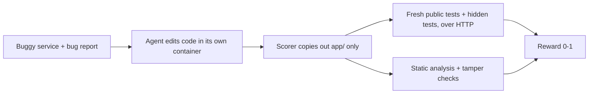

# secops-mcp-rlvr-gym

[](https://github.com/zariffromlatif/secops-mcp-rlvr-gym/actions/workflows/ci.yml)

**RL environments for coding and tool-using AI agents, with rewards that are hard to game.**

An agent gets a realistic job: fix a bug in a FastAPI + PostgreSQL service, or carry out a company
policy through MCP tools (payments, ledger, tickets, chat). It is scored by checks it never sees:
hidden tests, static analysis and checks on the final database state. Editing tests,
special-casing inputs or causing collateral damage earns nothing.

| | |
|---|---|
| **Tasks** | 21: 14 code repair (3 security, 11 business logic) and 7 MCP tool-use workflows |
| **Rewards** | hidden tests against a locked-down Docker sandbox, an AST static gate, anti-tampering checks, database-state GOAL/GUARD checks |
| **Quality control** | every task ships gold and no-op reference solutions, every workflow a careless one too; all re-validated in CI |
| **Packaging** | Prime Intellect [verifiers](https://github.com/PrimeIntellect-ai/verifiers) v1 environments, pushed to the Environments Hub |
| **Evaluated** | Qwen3.8-27B and gpt-oss-120b; 31 solutions audited with four verifier types |

## Key results

Tests alone are not enough, and neither is an LLM judge. In a 4-day evaluation, every solution was
re-scored by four verifiers: **V1** public tests, **V2** public + hidden tests, **V3** V2 plus static
and anti-tampering checks, and **V4** an LLM judge (gpt-oss-20b).

| Model | Patch tasks solved (V3) | Workflows solved (V3) |
|---|---|---|
| Qwen3.8-27B | 9 / 11 | 4 / 5 |
| gpt-oss-120b | 10 / 10 | 5 / 5 |

- **A test-only false positive.** Qwen's fix for a cross-tenant bug passed every public test but
  stopped saving updates. The hidden tests caught it.
- **What tests can't see.** Qwen made a SQL endpoint safe with an allow-list but still built the
  query with an f-string, which the task forbids. Every test passed it; the static gate (and the LLM
  judge) caught it.
- **LLM-judge false negatives.** The judge rejected three solutions that pass every test, once
  claiming that `datetime.combine` has no `tzinfo` argument (it has had one since Python 3.6).

These come from one attempt per task on a free API tier, so they are case studies rather than solve
rates. Details are in [results/evals/](results/evals/README.md). A research paper on verifier
errors in RL environments is in preparation.

## How a code-repair task is scored



The agent's code runs as an unprivileged process against a fresh database, and the tests reach it
only over HTTP, using pristine copies of the tests and seed data, so in-process tricks and edited
tests or data change nothing. Workflows are scored on the database state the agent leaves behind,
with a penalty for every collateral change.

## Tasks

**14 code-repair tasks.** The harder ones have a bug report that names one symptom, while the
documented rules hide two or three bugs; a fix of only the reported symptom still fails.

| Task | Category | Bug |
|---|---|---|
| `invoice_sort_001` | security (CWE-89) | ORDER BY built from raw query params |
| `invoice_tenant_002` | security (CWE-639) | Invoices readable/editable across tenants |
| `report_auth_003` | security (CWE-306) | Export endpoint skips authentication |
| `orders_pagination_004` | business logic | Page count rounds down, last page unreachable |
| `invoice_split_rounding_005` | business logic | Split shares lose leftover cents |
| `daily_report_timezone_006` | business logic | Daily report uses UTC days, ignores time zone |
| `revenue_double_count_007` | business logic | JOIN double-counts invoices with several payments |
| `subscription_proration_008` | business logic (hard) | 30-day month assumption + floor rounding |
| `inventory_reservation_009` | business logic (hard) | Duplicate SKU lines oversell + non-idempotent release |
| `tiered_pricing_010` | business logic (hard) | All-units instead of graduated pricing + exclusive bounds |
| `idempotency_keys_011` | business logic (hard) | Body mismatch not rejected + keys not tenant-scoped |
| `loyalty_points_expiry_012` | business logic (hard) | Expired points still counted + redemptions not oldest-first |
| `shipping_quote_013` | business logic | Volumetric weight ignored + rounds to nearest instead of up |
| `late_fees_014` | business logic (hard) | Fee on total, not outstanding + no grace period + no cap |

**7 MCP workflows**, graded on the final database state:

| Workflow | What the agent must do | Traps |
|---|---|---|
| `duplicate_webhook_refunds_101` | Refund duplicate charges, post a #billing summary | Legit repeat purchase, failed-then-retried charge, no PII in chat |
| `failed_payment_tickets_102` | Open tickets for customers with 3+ failures in March | Existing open ticket, closed ticket, February failures |
| `refund_request_tickets_103` | Apply a refund policy to the ticket queue | Too-old payment, already refunded, closed and unrelated tickets |
| `q1_vip_escalation_104` | Escalate Q1 VIPs, close duplicate tickets | Quarter boundaries, refunded/failed spend, case-sensitive titles |
| `refund_policy_v2_105` | Stacked refund policy | Prior-credit rule, one refund per customer per batch, 14-day boundary |
| `ledger_reconciliation_106` | Report payment/ledger mismatches as tickets, move no money | Partial credits that add up, duplicated credit, existing open ticket, refund tool available |
| `cancellation_refunds_107` | Refund the right payment for cancellation tickets | Latest payment failed, 30-day boundary to the second, ticket text asking for extra refunds |

See [docs/tasks-explained.md](docs/tasks-explained.md) for a walkthrough of every task and how to
write new ones. To evaluate models served on your own GPU instead of a hosted API, see
[docs/bracu-pc.md](docs/bracu-pc.md) and `scripts/local_batch.sh`.

## Layout

```
tasks/        patch tasks (app, public tests, hidden checks, gold/noop patches)
workflows/    MCP workflow tasks (seed, prompt, hidden state checks, trajectories)
environments/ Prime Intellect verifiers packages wrapping both task families
verifier/     multi-gate reward function
runtime/      Docker sandbox and episode runner
audit/        verifier audit: collect solutions, V1-V4 verdicts, blind labeling, analysis
scripts/      sync, image build, eval runner, results summarizer, Linux devbox
results/      model evaluation results and raw traces
docs/         study guide and planning notes
```

## Reward gates

| Gate | Weight | Checks |
|---|---|---|
| Format | -0.5 to +0.2 | Patch applies, Python parses, only `app/` is edited |
| Regression | +0.8 | Functional test suites pass, and read-only endpoints leave the stored data unchanged |
| Target / security | +1.5 | Hidden tests that only pass once the bug is fixed |
| Static analysis | +0.5 | No SQL built from runtime strings (f-strings, `+`, `%`, `.format`, `.join`), inline or through a variable |

The reward is the gate total divided by 3.0. A patch is **solved** only if every regression and
target test passes and the static gate passes. Every task ships a `gold.patch` (must be solved,
normalized score 1.0) and a `noop.patch` (must be unsolved with a security score of 0; it still earns
format, regression and static credit, 0.33-0.50). Patches that edit anything outside `app/`, such as
tests or seed data, score -0.5.

## Quick start

```bash
uv sync
uv run python runtime/validate_tasks.py --sandbox docker --repeat 3
uv run python runtime/score_patch.py --sandbox docker tasks/invoice_sort_001 path/to/your.patch
uv run python runtime/score_batch.py patches/ results.csv --workers 4
```

`score_batch.py` expects `patches/<task_id>/*.patch` (for example patches generated on Kaggle or
Colab) and writes one CSV row per patch.

## MCP workflows

```bash
uv sync --extra mcp
uv run python runtime/workflows.py validate
uv run python runtime/workflows.py score workflows/<id> trajectory.json
```

A trajectory is a JSON list of tool calls: `[{"tool": "issue_refund", "args": {...}}, ...]`.
Each episode gets a fresh database; tools run as an unprivileged `wf_agent` role (read-only SQL,
5 s statement timeout, no superuser functions). Each workflow offers only the tools listed in its
`task.yaml`, and calls past its `max_steps` are not run. Scoring = fraction of GOAL checks passed minus 0.5
per failed GUARD check (collateral damage such as wrong refunds or leaked PII).

To run a live agent over MCP:

```bash
uv run python runtime/workflows.py start workflows/duplicate_webhook_refunds_101   # prints WORKFLOW_DB_URL + prompt
WORKFLOW_DB_URL=... uv run python runtime/mcp_server.py workflows/duplicate_webhook_refunds_101  # stdio MCP server
uv run python runtime/workflows.py finish workflows/duplicate_webhook_refunds_101 <db_name>
```

Workflows use the Postgres from `docker compose -f runtime/docker-compose.yml up -d`.

## Prime Intellect environments

Both task families are packaged as [verifiers](https://github.com/PrimeIntellect-ai/verifiers) v1
environments under `environments/`:

| Package | Tasks | Harness | Runtime | `vf-validate` |
|---|---|---|---|---|
| `secops_gym_patches` | patch tasks | bash (agent edits code in a box) | Docker / Prime sandbox | 14/14 valid |
| `secops_gym_workflows` | MCP workflows | tool-only chat | subprocess + Postgres | 7/7 valid |

The repo holds v0.3.0: all 14 patch tasks and 7 workflows, the hardened scorer and per-workflow tool
lists. The Hub still has v0.2.1 (the first 11 patch tasks and 5 workflows) until v0.3.0 is pushed.

```bash
uv sync --extra mcp --extra envs              # Linux / macOS / WSL (verifiers is Unix-only)
uv run python scripts/sync_envs.py            # copy tasks + shared code into the packages
sh scripts/build_task_image.sh                # per-rollout box image (~300 MB)
uv run vf-validate secops_gym_patches --runtime.type docker
uv run vf-validate secops_gym_workflows --runtime.type subprocess
```

On Windows, run the same commands inside the Linux devbox: `sh scripts/devbox.sh uv run --no-sync vf-validate ...`.

Publishing: the task image is public at `ghcr.io/zariffromlatif/secops-gym-task:0.1` (rebuild it
with the **publish-task-image** GitHub Action). The in-box scorer ships with the package and is
copied into the box at scoring time, so scorer changes don't need a new image. Push each environment from its folder with the
`prime` CLI (`prime login`, then `prime env push --visibility PRIVATE` from the environment
folder). On Windows, set `PYTHONUTF8=1` first or the CLI crashes printing status symbols.

Hub (private, v0.2.1): `zariffromlatif/secops-gym-patches`, `zariffromlatif/secops-gym-workflows`.

## Verifier audit (the paper's measurement pipeline)

`audit/` re-scores every agent solution with four verifiers and compares them with blind human
labels:

| Verifier | Patch tasks | Workflows |
|---|---|---|
| V1 | public tests only | goal checks only |
| V2 | public + hidden tests | (none) |
| V3 | multi-signal: V2 + static analysis + format/tamper gates | goal + guard checks |
| V4 | LLM judge (task, original code, diff) | LLM judge (task, tool calls + results) |

```bash
uv run python -m audit.collect .tmp/evals/<run> ... --out results/audit/solutions.jsonl
uv run python -m audit.verify results/audit/solutions.jsonl --judge-model openai/gpt-oss-20b
uv run python -m audit.labels results/audit/solutions.jsonl --out results/audit/labeling
#   two annotators fill sheet_A.csv / sheet_B.csv independently (see GUIDELINES.md)
uv run python -m audit.analyze results/audit/verdicts.csv results/audit/labeling
```

The analysis reports Cohen's kappa between annotators and, per verifier, false-positive and
false-negative rates with 95% bootstrap confidence intervals. Judge answers are cached, so
re-running never spends quota twice. The judge and the annotators see the same full tool results
the agent saw.

## Sandbox

`--sandbox docker` scores each patch in its own throwaway environment:

- an internal Docker network with **no internet access**
- a fresh Postgres per episode (data on tmpfs)
- the patched app in its own container: read-only filesystem, non-root, all capabilities dropped,
  memory / CPU / process limits, and a database role that can only read and write rows
- tests in a separate container that reaches the app over HTTP, so the agent's code never runs
  inside the test process and cannot tamper with results
- hidden tests mounted read-only, only at scoring time
- everything removed afterwards, even on errors

The sandbox image (~290 MB) builds automatically on first use and is rebuilt when
`runtime/Dockerfile.sandbox` or `runtime/requirements-sandbox.txt` changes.

### Local mode

Without `--sandbox docker`, tests import the app in-process against a Postgres on port 5433
(`docker compose -f runtime/docker-compose.yml up -d`). It is faster for writing tasks but not
isolated. Set `DATABASE_URL` to use a different Postgres.

## Author

Md. Zarif Latif, BRAC University, Dhaka · [github.com/zariffromlatif](https://github.com/zariffromlatif)
